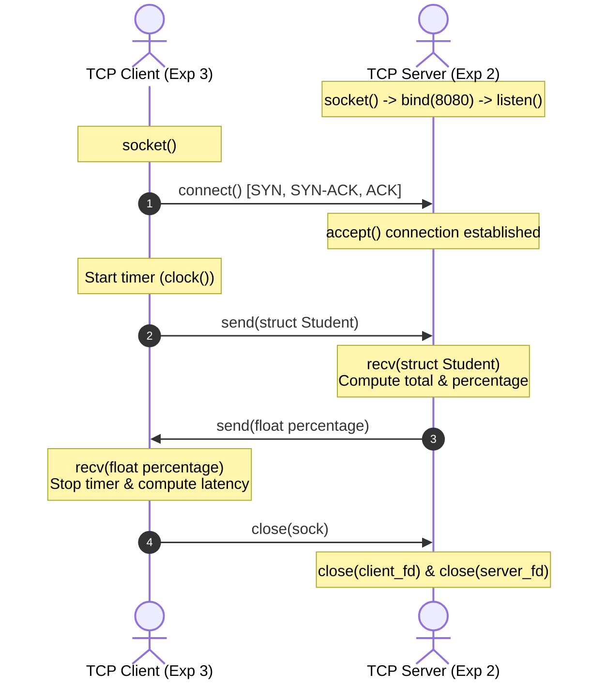
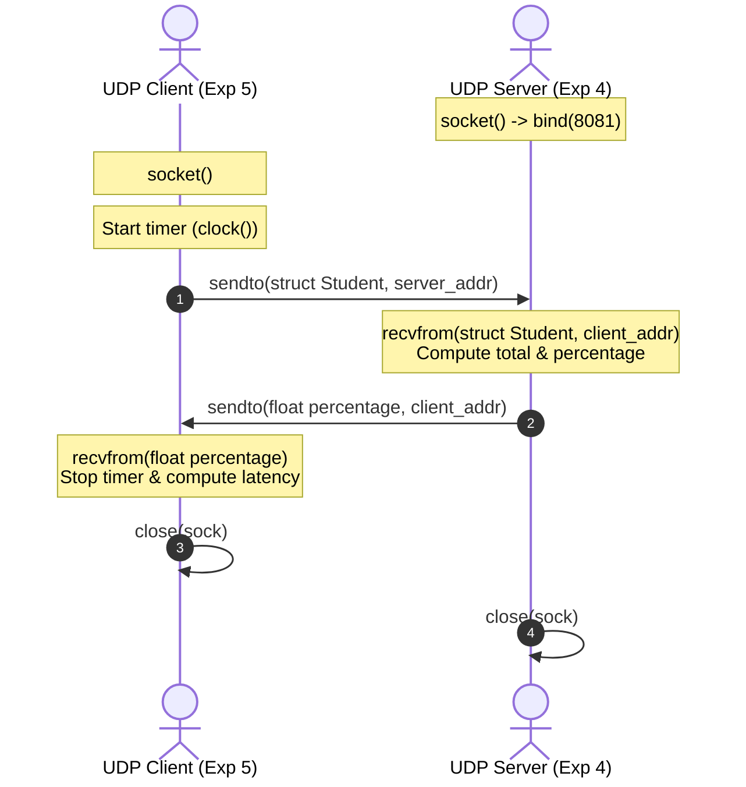

# Computer Networks Lab (Socket Programming)

A repository for Computer Networks Laboratory assignments featuring Berkeley Socket Programming in C for both **Transmission Control Protocol (TCP)** and **User Datagram Protocol (UDP)**.

---

## Table of Contents

- [Overview](#overview)
- [Directory Structure](#directory-structure)
- [Experiments Summary](#experiments-summary)
  - [Experiment 2: TCP Server](#experiment-2-tcp-server)
  - [Experiment 3: TCP Client](#experiment-3-tcp-client)
  - [Experiment 4: UDP Server](#experiment-4-udp-server)
  - [Experiment 5: UDP Client](#experiment-5-udp-client)
- [Protocol Workflow Diagrams](#protocol-workflow-diagrams)
  - [TCP Client-Server Communication](#tcp-client-server-communication)
  - [UDP Client-Server Communication](#udp-client-server-communication)
- [TCP vs. UDP Comparison](#tcp-vs-udp-comparison)
- [Prerequisites](#prerequisites)
- [Compilation & Execution](#compilation--execution)
  - [Option 1: Using Makefile (Recommended)](#option-1-using-makefile-recommended)
  - [Option 2: Using GCC Manually](#option-2-using-gcc-manually)
- [Sample Input & Output](#sample-input--output)

---

## Overview

This repository demonstrates client-server networking using socket programming in C. 

The application model across all experiments:
1. **Client**: Collects student information (`name`, `prn`, and marks for 5 subjects), encapsulates them in a C `struct Student`, records the timestamp before sending, transmits the struct across the network to the server, and measures the round-trip latency upon receiving the response.
2. **Server**: Receives the student data, parses the subject marks, computes the aggregate percentage, and replies with the percentage as a floating-point value.

```c
struct Student {
    char name[50];
    char prn[30];
    float marks[5];
};
```

---

## Directory Structure

```text
CN/
├── .gitignore
├── Makefile
├── README.md
├── Exp-02-TCP-Server/
│   ├── README.md
│   └── tcp_server.c
├── Exp-03-TCP-Client/
│   ├── README.md
│   └── tcp_client.c
├── Exp-04-UDP-Server/
│   ├── README.md
│   └── udp_server.c
└── Exp-05-UDP-Client/
    ├── README.md
    └── udp_client.c
```

---

## Experiments Summary

| Experiment | Program | Protocol | Socket Type | Port | Description |
|:---:|:---|:---:|:---:|:---:|:---|
| **Exp 2** | [`tcp_server.c`](./Exp-02-TCP-Server/tcp_server.c) | TCP | `SOCK_STREAM` | `8080` | Connection-oriented server that accepts TCP clients, receives student data, computes percentage, and sends the result. |
| **Exp 3** | [`tcp_client.c`](./Exp-03-TCP-Client/tcp_client.c) | TCP | `SOCK_STREAM` | `8080` | Connection-oriented client that connects to the server, sends student details, and measures round-trip response time. |
| **Exp 4** | [`udp_server.c`](./Exp-04-UDP-Server/udp_server.c) | UDP | `SOCK_DGRAM` | `8081` | Connectionless server that receives student datagrams via `recvfrom()`, calculates percentage, and responds using `sendto()`. |
| **Exp 5** | [`udp_client.c`](./Exp-05-UDP-Client/udp_client.c) | UDP | `SOCK_DGRAM` | `8081` | Connectionless client that transmits student datagrams via `sendto()`, receives calculated percentage via `recvfrom()`, and measures latency. |

---

## Protocol Workflow Diagrams

### TCP Client-Server Communication



---

### UDP Client-Server Communication



---

## TCP vs. UDP Comparison

| Feature | TCP (Exp 2 & 3) | UDP (Exp 4 & 5) |
|:---|:---|:---|
| **Connection Type** | Connection-oriented (Handshake required) | Connectionless (No handshake) |
| **Socket Type** | `SOCK_STREAM` | `SOCK_DGRAM` |
| **System Calls** | `socket`, `bind`, `listen`, `accept`, `connect`, `send`, `recv` | `socket`, `bind`, `sendto`, `recvfrom` |
| **Reliability** | High (acknowledgments, retransmission) | Best-effort (packets can be lost/reordered) |
| **Header Overhead** | 20–60 bytes | 8 bytes |
| **Latency / Speed** | Higher overhead due to handshake and ACK | Lower latency, faster transmission |

---

## Prerequisites

- Operating System: **Linux**, **WSL (Windows Subsystem for Linux)**, or **macOS**
- Compiler: `gcc`
- Build utility: `make` (optional)

---

## Compilation & Execution

### Option 1: Using Makefile (Recommended)

1. **Build all programs at once:**
   ```bash
   make all
   ```

2. **Run TCP Session:**
   - **Terminal 1 (Server):**
     ```bash
     ./Exp-02-TCP-Server/tcp_server
     ```
   - **Terminal 2 (Client):**
     ```bash
     ./Exp-03-TCP-Client/tcp_client
     ```

3. **Run UDP Session:**
   - **Terminal 1 (Server):**
     ```bash
     ./Exp-04-UDP-Server/udp_server
     ```
   - **Terminal 2 (Client):**
     ```bash
     ./Exp-05-UDP-Client/udp_client
     ```

4. **Clean binaries:**
   ```bash
   make clean
   ```

---

### Option 2: Using GCC Manually

#### TCP (Experiments 2 & 3)

**Terminal 1 — Server:**
```bash
cd Exp-02-TCP-Server
gcc tcp_server.c -o tcp_server
./tcp_server
```

**Terminal 2 — Client:**
```bash
cd Exp-03-TCP-Client
gcc tcp_client.c -o tcp_client
./tcp_client
```

---

#### UDP (Experiments 4 & 5)

**Terminal 1 — Server:**
```bash
cd Exp-04-UDP-Server
gcc udp_server.c -o udp_server
./udp_server
```

**Terminal 2 — Client:**
```bash
cd Exp-05-UDP-Client
gcc udp_client.c -o udp_client
./udp_client
```

---

## Sample Input & Output

### 1. TCP Execution

#### Server Output:
```text
TCP Server started...
Waiting for client...

Student Details Received:
Name : Alice Johnson
PRN : 1032210012
Subject 1 Marks : 85.50
Subject 2 Marks : 90.00
Subject 3 Marks : 78.50
Subject 4 Marks : 88.00
Subject 5 Marks : 92.00
Percentage calculated: 86.80%
```

#### Client Output:
```text
Connected to TCP Server.

Enter student name: Alice Johnson
Enter PRN: 1032210012
Enter marks for Subject 1: 85.5
Enter marks for Subject 2: 90
Enter marks for Subject 3: 78.5
Enter marks for Subject 4: 88
Enter marks for Subject 5: 92

----- Result -----
Student Name : Alice Johnson
PRN          : 1032210012
Percentage   : 86.80%
Response Time: 0.421 ms
```

---

### 2. UDP Execution

#### Server Output:
```text
UDP Server started...
Waiting for client data...

Student Details Received:
Name : Bob Smith
PRN : 1032210045
Subject 1 Marks : 76.00
Subject 2 Marks : 82.50
Subject 3 Marks : 91.00
Subject 4 Marks : 84.00
Subject 5 Marks : 79.50
Percentage calculated: 82.60%
```

#### Client Output:
```text
UDP Client started.

Enter student name: Bob Smith
Enter PRN: 1032210045
Enter marks for Subject 1: 76
Enter marks for Subject 2: 82.5
Enter marks for Subject 3: 91
Enter marks for Subject 4: 84
Enter marks for Subject 5: 79.5

----- Result -----
Student Name : Bob Smith
PRN          : 1032210045
Percentage   : 82.60%
Response Time: 0.185 ms
```
