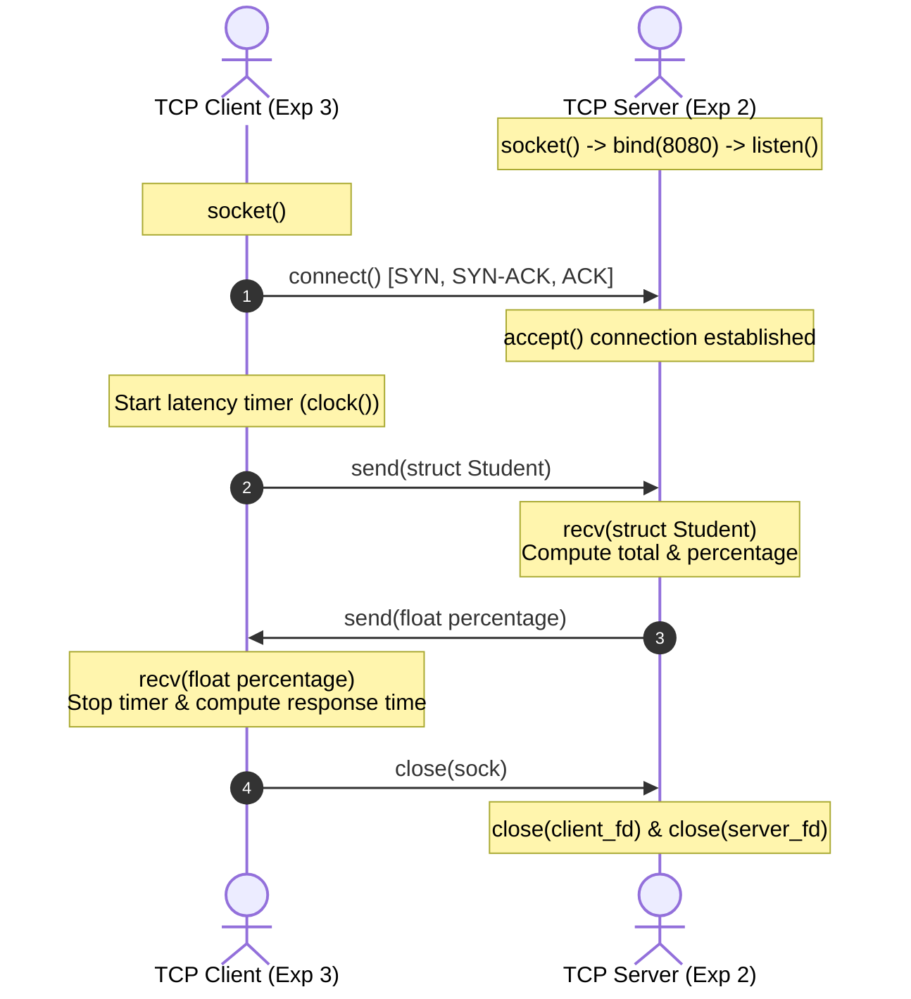
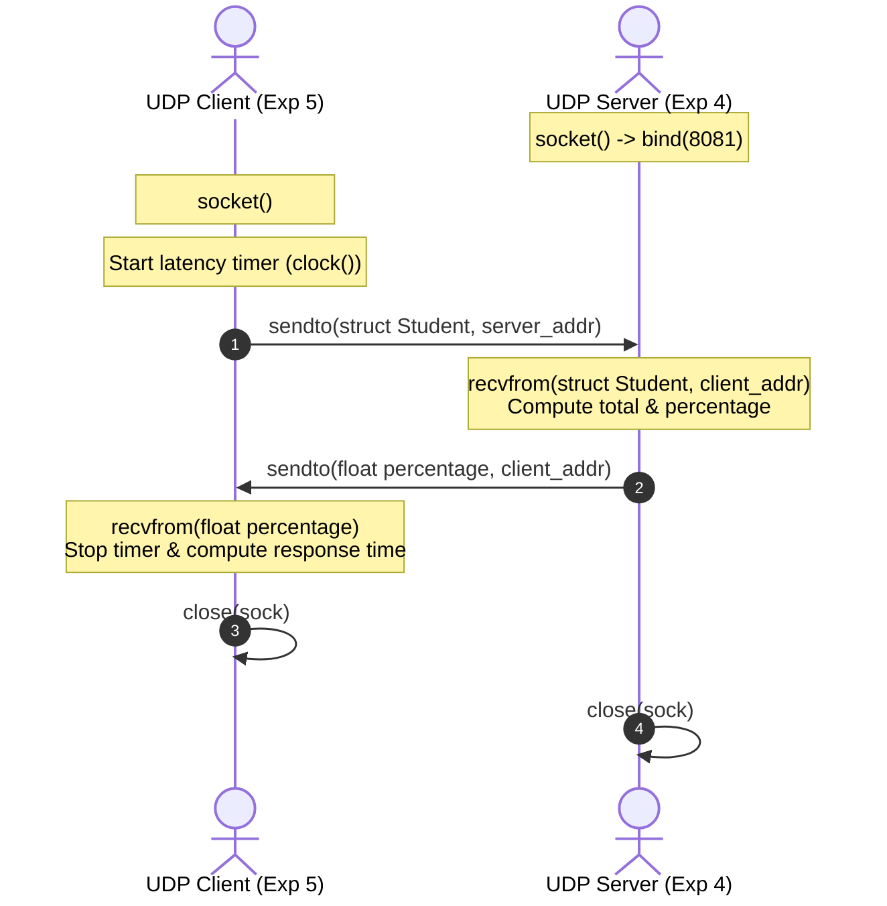
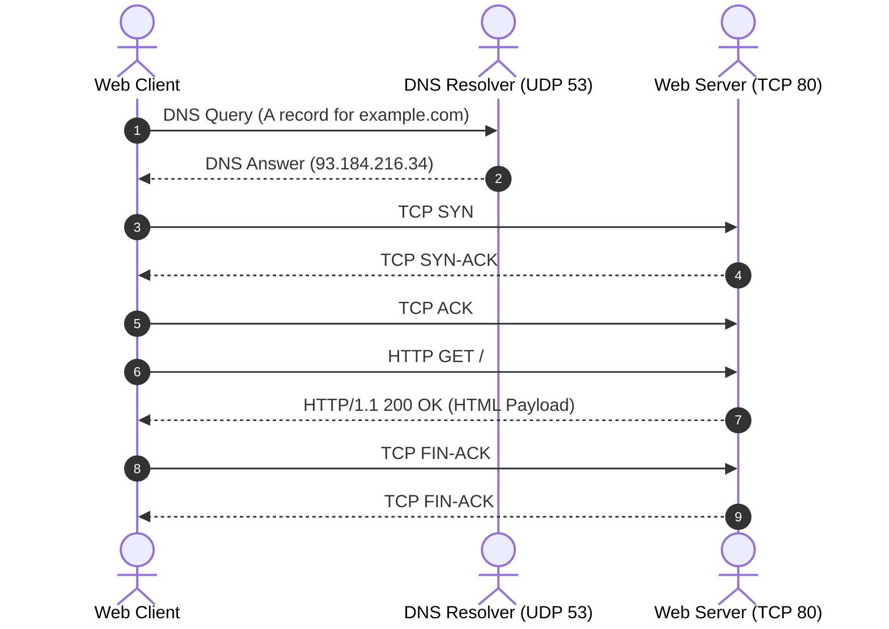

# Computer Networks Laboratory

Comprehensive implementation, packet captures, and simulation assignments for the Computer Networks (CN) Laboratory curriculum.

---

## Table of Contents

- [Overview](#overview)
- [Repository Structure](#repository-structure)
- [Experiments Index](#experiments-index)
  - [Socket Programming (Exp 2 – 5)](#socket-programming-exp-2--5)
  - [Packet Analysis & Protocols (Exp 6 – 7)](#packet-analysis--protocols-exp-6--7)
  - [Data Link Layer Protocols (Exp 8)](#data-link-layer-protocols-exp-8)
  - [Traffic Shaping & Congestion Control (Exp 9)](#traffic-shaping--congestion-control-exp-9)
  - [Routing Algorithms (Exp 10)](#routing-algorithms-exp-10)
- [Architecture & Sequence Diagrams](#architecture--sequence-diagrams)
  - [TCP Client-Server Flow](#tcp-client-server-flow)
  - [UDP Client-Server Flow](#udp-client-server-flow)
  - [DNS & HTTP Request Flow](#dns--http-request-flow)
- [Compilation & Execution Guide](#compilation--execution-guide)
  - [Quick Build (Makefile)](#quick-build-makefile)
  - [Individual Execution](#individual-execution)
- [Summary Table](#summary-table)

---

## Overview

This repository contains lab assignments covering transport protocols, socket programming, application-layer packet inspection, flow control, traffic shaping, and dynamic network routing.

- **Socket Programming:** C client-server implementations with Berkeley sockets over TCP and UDP, transmitting structured binary data (`struct Student`) and computing round-trip latency.
- **Packet Inspection:** Wireshark capture and protocol analysis for DNS (`A`, `PTR`, `MX` lookups) and HTTP request/response flows.
- **Flow & Congestion Control:** Simulation of Go-Back-N Sliding Window ARQ, Leaky Bucket, and Token Bucket algorithms.
- **Routing:** Distance Vector Routing based on iterative Bellman-Ford shortest-path relaxations.

---

## Repository Structure

```text
CN/
├── .gitignore
├── Makefile
├── README.md
├── Exp-02-TCP-Server/
│   ├── README.md
│   └── tcp_server.c
├── Exp-03-TCP-Client/
│   ├── README.md
│   └── tcp_client.c
├── Exp-04-UDP-Server/
│   ├── README.md
│   └── udp_server.c
├── Exp-05-UDP-Client/
│   ├── README.md
│   └── udp_client.c
├── Exp-06-DNS-Packet-Analysis/
│   └── README.md
├── Exp-07-DNS-HTTP-Packet-Analysis/
│   └── README.md
├── Exp-08-Sliding-Window-Protocol/
│   ├── README.md
│   └── sliding_window279.c
├── Exp-09-Traffic-Shaping/
│   ├── README.md
│   ├── exp9_279.c          # Leaky Bucket
│   └── exp9_2_279.c        # Token Bucket
└── Exp-10-Distance-Vector-Routing/
    ├── README.md
    └── exp10_279.c
```

---

## Experiments Index

### Socket Programming (Exp 2 – 5)

| Experiment | Title | Protocol | Port | Source |
| :---: | :--- | :---: | :---: | :--- |
| **Exp 2** | [TCP Socket Server](./Exp-02-TCP-Server/) | TCP (`SOCK_STREAM`) | `8080` | [`tcp_server.c`](./Exp-02-TCP-Server/tcp_server.c) |
| **Exp 3** | [TCP Socket Client](./Exp-03-TCP-Client/) | TCP (`SOCK_STREAM`) | `8080` | [`tcp_client.c`](./Exp-03-TCP-Client/tcp_client.c) |
| **Exp 4** | [UDP Socket Server](./Exp-04-UDP-Server/) | UDP (`SOCK_DGRAM`) | `8081` | [`udp_server.c`](./Exp-04-UDP-Server/udp_server.c) |
| **Exp 5** | [UDP Socket Client](./Exp-05-UDP-Client/) | UDP (`SOCK_DGRAM`) | `8081` | [`udp_client.c`](./Exp-05-UDP-Client/udp_client.c) |

### Packet Analysis & Protocols (Exp 6 – 7)

| Experiment | Title | Tools | Filter | Guide |
| :---: | :--- | :---: | :---: | :--- |
| **Exp 6** | [DNS Packet Analysis](./Exp-06-DNS-Packet-Analysis/) | `nslookup`, Wireshark | `dns` | [Lab Manual](./Exp-06-DNS-Packet-Analysis/README.md) |
| **Exp 7** | [DNS & HTTP Packet Analysis](./Exp-07-DNS-HTTP-Packet-Analysis/) | Browser/curl, Wireshark | `dns \|\| http` | [Lab Manual](./Exp-07-DNS-HTTP-Packet-Analysis/README.md) |

### Flow, Traffic Shaping & Routing (Exp 8 – 10)

| Experiment | Title | Description | Source |
| :---: | :--- | :--- | :--- |
| **Exp 8** | [Sliding Window Protocol](./Exp-08-Sliding-Window-Protocol/) | Go-Back-N ARQ simulation with interactive acknowledgment & retransmission. | [`sliding_window279.c`](./Exp-08-Sliding-Window-Protocol/sliding_window279.c) |
| **Exp 9** | [Traffic Shaping Algorithms](./Exp-09-Traffic-Shaping/) | Leaky Bucket (constant leak rate) & Token Bucket (bursty transmission). | [`exp9_279.c`](./Exp-09-Traffic-Shaping/exp9_279.c), [`exp9_2_279.c`](./Exp-09-Traffic-Shaping/exp9_2_279.c) |
| **Exp 10** | [Distance Vector Routing](./Exp-10-Distance-Vector-Routing/) | Dynamic routing table calculation using Bellman-Ford algorithm. | [`exp10_279.c`](./Exp-10-Distance-Vector-Routing/exp10_279.c) |

---

## Architecture & Sequence Diagrams

### TCP Client-Server Flow



---

### UDP Client-Server Flow



---

### DNS & HTTP Request Flow



---

## Compilation & Execution Guide

### Quick Build (Makefile)

```bash
# Build all executable programs across all experiments
make all

# Clean all generated binaries
make clean
```

Target-specific builds:
- `make exp2` — TCP Server
- `make exp3` — TCP Client
- `make exp4` — UDP Server
- `make exp5` — UDP Client
- `make exp8` — Sliding Window Protocol
- `make exp9` — Leaky and Token Bucket
- `make exp10` — Distance Vector Routing

---

### Individual Execution

#### 1. TCP Socket Programming (Exp 2 & 3)
```bash
# Terminal 1: Run TCP Server
cd Exp-02-TCP-Server && gcc tcp_server.c -o tcp_server && ./tcp_server

# Terminal 2: Run TCP Client
cd Exp-03-TCP-Client && gcc tcp_client.c -o tcp_client && ./tcp_client
```

#### 2. UDP Socket Programming (Exp 4 & 5)
```bash
# Terminal 1: Run UDP Server
cd Exp-04-UDP-Server && gcc udp_server.c -o udp_server && ./udp_server

# Terminal 2: Run UDP Client
cd Exp-05-UDP-Client && gcc udp_client.c -o udp_client && ./udp_client
```

#### 3. Wireshark Packet Analysis (Exp 6 & 7)
- **Exp 6 (DNS):**
  ```cmd
  nslookup www.example.com
  nslookup 93.184.216.34
  nslookup -query=MX example.com
  ```
  *Filter in Wireshark:* `dns`

- **Exp 7 (DNS & HTTP):**
  ```cmd
  nslookup www.google.com
  curl -I http://example.com
  ```
  *Filter in Wireshark:* `dns || http`

#### 4. Sliding Window Protocol (Exp 8)
```bash
cd Exp-08-Sliding-Window-Protocol
gcc sliding_window279.c -o sliding_window279
./sliding_window279
```

#### 5. Traffic Shaping Algorithms (Exp 9)
```bash
cd Exp-09-Traffic-Shaping

# Leaky Bucket
gcc exp9_279.c -o exp9_279
./exp9_279

# Token Bucket
gcc exp9_2_279.c -o exp9_2_279
./exp9_2_279
```

#### 6. Distance Vector Routing (Exp 10)
```bash
cd Exp-10-Distance-Vector-Routing
gcc exp10_279.c -o exp10_279
./exp10_279
```

---

## Summary Table

| Exp | Topic | Protocol / Alg | Type | Output / Goal |
| :---: | :--- | :--- | :--- | :--- |
| **02** | TCP Socket Server | TCP | C / Sockets | Receives student data, calculates aggregate percentage |
| **03** | TCP Socket Client | TCP | C / Sockets | Transmits student record, measures round-trip response time |
| **04** | UDP Socket Server | UDP | C / Sockets | Connectionless percentage calculation server |
| **05** | UDP Socket Client | UDP | C / Sockets | Connectionless client with latency measurement |
| **06** | DNS Packet Inspection | DNS | Packet Capture | Forward lookup (`A`), reverse lookup (`PTR`), mail exchange (`MX`) |
| **07** | DNS & HTTP Inspection | DNS, HTTP | Packet Capture | DNS query resolution followed by HTTP GET request/response cycle |
| **08** | Flow Control | Go-Back-N ARQ | C Simulation | Simulates pipelining, cumulative ACK, and window reset on loss |
| **09** | Congestion Control | Leaky & Token Bucket | C Simulation | Constant rate shaping vs. burst-tolerant token depletion |
| **10** | Routing Algorithms | Distance Vector (Bellman-Ford) | C Simulation | Shortest-path routing tables with convergence tracking |
