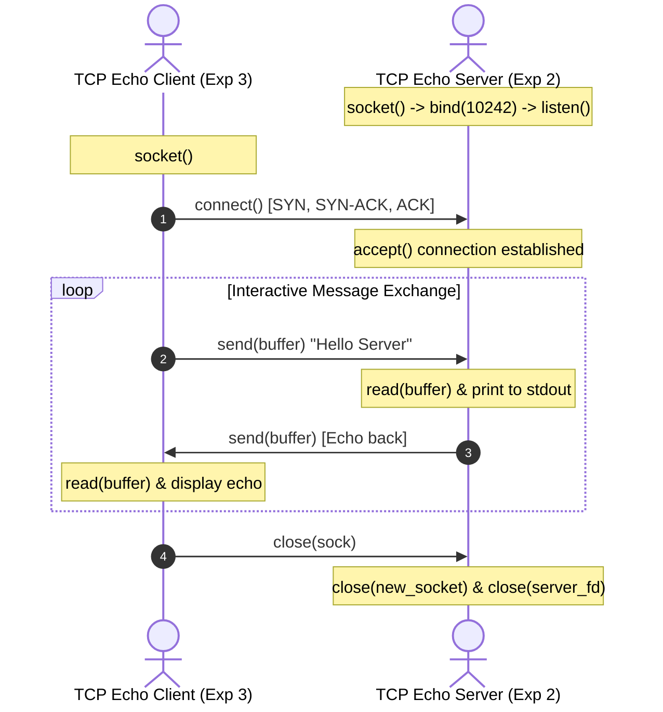
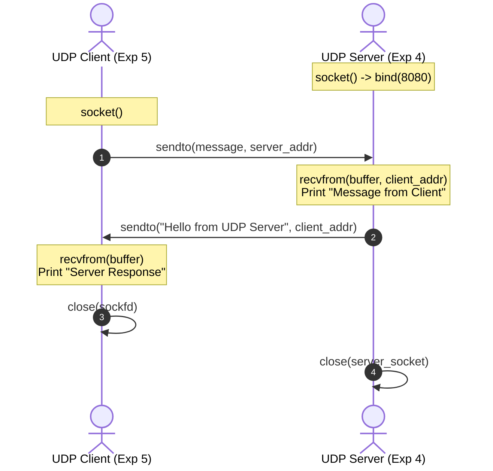

<!-- =========================== HERO =========================== -->
<div align="center">

<h1>JASH CHAUHAN</h1>

<h2>🌐 COMPUTER NETWORKS LABORATORY</h2>

<p><strong>A hands-on collection of networking experiments, implementations, and protocol analysis.</strong></p>

<p>
  <a href="https://github.com/jashchauhan06"></a>
  <a href="https://github.com/jashchauhan06/cn"></a>
  
</p>

<p>
  <a href="https://github.com/jashchauhan06/cn"></a>
  <a href="https://github.com/jashchauhan06/cn"></a>
  
</p>

<p><strong><a href="#experiments-index">Browse Experiments</a> · <a href="https://github.com/jashchauhan06/cn">View Repository</a> · <a href="#compilation--execution-guide">Run the Programs</a></strong></p>

<sub>Maintained by <a href="https://github.com/jashchauhan06"><b>Jash Chauhan</b></a>.</sub>

</div>

---

## Contents

- [Overview](#overview)
- [Quick Start](#quick-start)
- [Repository Structure](#repository-structure)
- [Experiments Index](#experiments-index)
  - [Network Topology & File Sharing (Exp 1)](#network-topology--file-sharing-exp-1)
  - [Socket Programming (Exp 2–5)](#socket-programming-exp-25)
  - [Packet Analysis (Exp 6–7)](#packet-analysis--protocols-exp-6--7)
  - [Flow Control & Routing (Exp 8–10)](#flow-traffic-shaping--routing-exp-810)
- [Architecture & Sequence Diagrams](#architecture--sequence-diagrams)
- [Compilation & Execution Guide](#compilation--execution-guide)
- [Summary Table](#summary-table)

---

## Overview

This repository brings together **10 Computer Networks laboratory experiments**, spanning network topology and file sharing, socket programming, packet inspection, flow control, traffic shaping, and routing. Each experiment is organized in its own folder for easy reference.

- **Network Topology & File Sharing (Exp 1):** Work focused on network topologies and sharing files across a network.
- **TCP Echo Socket Programming (Exp 2 & 3):** C client-server implementation of a full-duplex TCP Echo service on port `10242` (`10000 + PRN`).
- **UDP Socket Programming (Exp 4 & 5):** Connectionless UDP client-server message exchange on port `8080`.
- **Packet Inspection (Exp 6 & 7):** Wireshark capture and protocol analysis for DNS (`A`, `PTR`, `MX` lookups) and HTTP request/response flows.
- **Flow & Congestion Control (Exp 8 & 9):** Simulation of Go-Back-N Sliding Window ARQ, Leaky Bucket, and Token Bucket algorithms.
- **Routing (Exp 10):** Distance Vector Routing based on iterative Bellman-Ford shortest-path relaxations.

---

## Quick Start

Clone the project and open the experiment that interests you:

```bash
git clone https://github.com/jashchauhan06/cn.git
cd cn
```

**What you'll need:** A C compiler such as GCC for the C programs; Wireshark, `nslookup`, and `curl` for the packet-analysis activities. For Experiment 1, consult the assets in its folder to determine the required topology and file-sharing environment.

> **Tip:** Start with the [experiment directory](#experiments-index), then use the matching section in the [execution guide](#compilation--execution-guide). Run TCP or UDP clients and servers in separate terminals.

---

## Repository Structure

```text
cn/
├── README.md
├── Exp-01-Topology-File-Sharing/  # Network topology and file sharing
├── Exp-02-TCP-Server/
│   ├── README.md
│   └── server1242.c
├── Exp-03-TCP-Client/
│   ├── README.md
│   └── client1242.c
├── Exp-04-UDP-Server/
│   ├── README.md
│   └── server_udp242.c
├── Exp-05-UDP-Client/
│   ├── README.md
│   └── client_udp_242.c
├── Exp-06-DNS-Packet-Analysis/
│   └── README.md
├── Exp-07-DNS-HTTP-Packet-Analysis/
│   └── README.md
├── Exp-08-Sliding-Window-Protocol/
│   ├── README.md
│   └── sliding_window242.c
├── Exp-09-Traffic-Shaping/
│   ├── README.md
│   ├── exp9_242.c          # Leaky Bucket
│   └── exp9_2_242.c        # Token Bucket
└── Exp-10-Distance-Vector-Routing/
    ├── README.md
    └── exp10_242.c
```

---

## Experiments Index

### Network Topology & File Sharing (Exp 1)

| Experiment | Focus | Lab Folder |
| :---: | :--- | :--- |
| **Exp 1** | Network topology and file sharing | **[Explore Experiment 1](./Exp-01-Topology-File-Sharing/)** |

> Experiment 1 has been added to the repository. Its contents are linked via the folder above; individual filenames and run steps are intentionally not assumed here.

### Socket Programming (Exp 2–5)

| Experiment | Title | Protocol | Port | Source |
| :---: | :--- | :---: | :---: | :--- |
| **Exp 2** | [TCP Echo Server](./Exp-02-TCP-Server/) | TCP (`SOCK_STREAM`) | `10242` | [`server1242.c`](./Exp-02-TCP-Server/server1242.c) |
| **Exp 3** | [TCP Echo Client](./Exp-03-TCP-Client/) | TCP (`SOCK_STREAM`) | `10242` | [`client1242.c`](./Exp-03-TCP-Client/client1242.c) |
| **Exp 4** | [UDP Server](./Exp-04-UDP-Server/) | UDP (`SOCK_DGRAM`) | `8080` | [`server_udp242.c`](./Exp-04-UDP-Server/server_udp242.c) |
| **Exp 5** | [UDP Client](./Exp-05-UDP-Client/) | UDP (`SOCK_DGRAM`) | `8080` | [`client_udp_242.c`](./Exp-05-UDP-Client/client_udp_242.c) |

### Packet Analysis & Protocols (Exp 6 – 7)

| Experiment | Title | Tools | Filter | Guide |
| :---: | :--- | :---: | :---: | :--- |
| **Exp 6** | [DNS Packet Analysis](./Exp-06-DNS-Packet-Analysis/) | `nslookup`, Wireshark | `dns` | [Lab Manual](./Exp-06-DNS-Packet-Analysis/README.md) |
| **Exp 7** | [DNS & HTTP Packet Analysis](./Exp-07-DNS-HTTP-Packet-Analysis/) | Browser/curl, Wireshark | `dns \|\| http` | [Lab Manual](./Exp-07-DNS-HTTP-Packet-Analysis/README.md) |

### Flow, Traffic Shaping & Routing (Exp 8–10)

| Experiment | Title | Description | Source |
| :---: | :--- | :--- | :--- |
| **Exp 8** | [Sliding Window Protocol](./Exp-08-Sliding-Window-Protocol/) | Go-Back-N ARQ simulation with interactive acknowledgment & retransmission. | [`sliding_window242.c`](./Exp-08-Sliding-Window-Protocol/sliding_window242.c) |
| **Exp 9** | [Traffic Shaping Algorithms](./Exp-09-Traffic-Shaping/) | Leaky Bucket (constant leak rate) & Token Bucket (bursty transmission). | [`exp9_242.c`](./Exp-09-Traffic-Shaping/exp9_242.c), [`exp9_2_242.c`](./Exp-09-Traffic-Shaping/exp9_2_242.c) |
| **Exp 10** | [Distance Vector Routing](./Exp-10-Distance-Vector-Routing/) | Dynamic routing table calculation using Bellman-Ford algorithm. | [`exp10_242.c`](./Exp-10-Distance-Vector-Routing/exp10_242.c) |

---

## Architecture & Sequence Diagrams

### TCP Echo Client-Server Flow (Exp 2 & 3)



---

### UDP Client-Server Flow (Exp 4 & 5)



---

### DNS & HTTP Request Flow (Exp 6 & 7)


---

## Compilation & Execution Guide

### Experiment 1 — Network Topology & File Sharing

Open **[Exp-01-Topology-File-Sharing](./Exp-01-Topology-File-Sharing/)** to access the network-topology and file-sharing materials. The required application or workflow depends on the files in that folder; unlike the socket programs below, there is no single verified GCC command for this experiment.

### Experiments 2 & 3 — TCP Echo Socket Programming
```bash
# Terminal 1: Run TCP Echo Server
cd Exp-02-TCP-Server
gcc server1242.c -o server
./server

# Terminal 2: Run TCP Echo Client
cd Exp-03-TCP-Client
gcc client1242.c -o client
./client
```

### Experiments 4 & 5 — UDP Socket Programming
```bash
# Terminal 1: Run UDP Server
cd Exp-04-UDP-Server
gcc server_udp242.c -o server
./server

# Terminal 2: Run UDP Client
cd Exp-05-UDP-Client
gcc client_udp_242.c -o client
./client
```

### Experiments 6 & 7 — Wireshark Packet Analysis
- **Exp 6 (DNS):**
  ```cmd
  nslookup www.example.com
  nslookup 93.184.216.34
  nslookup -query=MX example.com
  ```
  *Filter in Wireshark:* `dns`

- **Exp 7 (DNS & HTTP):**
  ```cmd
  nslookup www.google.com
  curl -I http://example.com
  ```
  *Filter in Wireshark:* `dns || http`

### Experiment 8 — Sliding Window Protocol
```bash
cd Exp-08-Sliding-Window-Protocol
gcc sliding_window242.c -o sliding_window242
./sliding_window242
```

### Experiment 9 — Traffic Shaping Algorithms
```bash
cd Exp-09-Traffic-Shaping

# Leaky Bucket
gcc exp9_242.c -o exp9_242
./exp9_242

# Token Bucket
gcc exp9_2_242.c -o exp9_2_242
./exp9_2_242
```

### Experiment 10 — Distance Vector Routing
```bash
cd Exp-10-Distance-Vector-Routing
gcc exp10_242.c -o exp10_242
./exp10_242
```

---

## Summary Table

| Exp | Topic | Protocol / Alg | Type | Output / Goal |
| :---: | :--- | :--- | :--- | :--- |
| **01** | Network Topology & File Sharing | Network Topologies / File Sharing | Lab Activity | Explore topology and file-sharing experiment materials |
| **02** | TCP Echo Server | TCP | C / Sockets | Listens on port `10242`, receives and echoes incoming client messages |
| **03** | TCP Echo Client | TCP | C / Sockets | Connects to port `10242`, sends user text, displays echoed response |
| **04** | UDP Server | UDP | C / Sockets | Listens on port `8080`, prints client message, replies with `"Hello from UDP Server"` |
| **05** | UDP Client | UDP | C / Sockets | Sends message to port `8080`, displays server reply |
| **06** | DNS Packet Inspection | DNS | Packet Capture | Forward lookup (`A`), reverse lookup (`PTR`), mail exchange (`MX`) |
| **07** | DNS & HTTP Inspection | DNS, HTTP | Packet Capture | DNS query resolution followed by HTTP GET request/response cycle |
| **08** | Flow Control | Go-Back-N ARQ | C Simulation | Simulates pipelining, cumulative ACK, and window reset on loss |
| **09** | Congestion Control | Leaky & Token Bucket | C Simulation | Constant rate shaping vs. burst-tolerant token depletion |
| **10** | Routing Algorithms | Distance Vector (Bellman-Ford) | C Simulation | Shortest-path routing tables with convergence tracking |
---

<div align="center">

<p><strong>Owner <a href="https://github.com/jashchauhan06">Jash Chauhan</a></strong></p>
<p>Computer Networks Laboratory · Experiments 01–10</p>
<p><a href="#jash-chauhan">↑ Back to Top</a></p>

</div>
